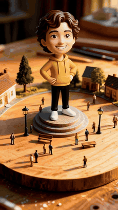
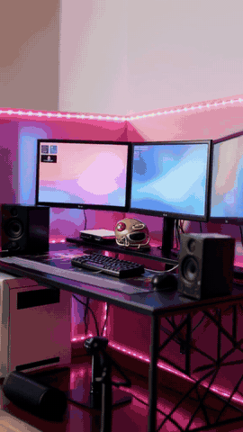
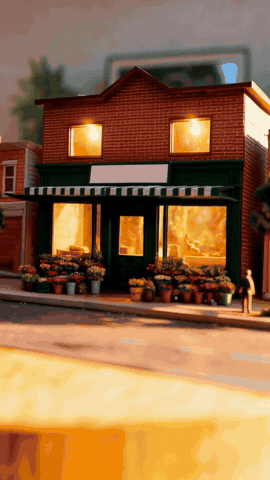
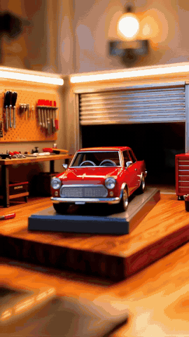
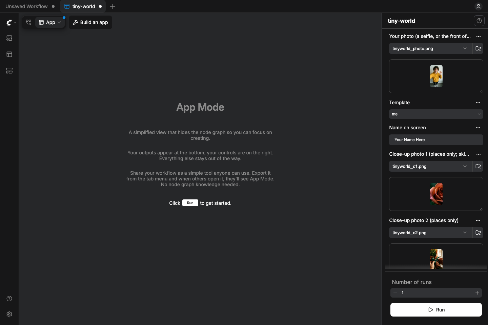

# Tiny World

**One photo → a tiny handmade diorama of it → the camera flies in → it becomes the real place.**

**Selfie mode (the default):** one selfie → you as a collectible figurine (or a knitted plushie) standing on a pedestal in a
tiny town → the camera flies in → one continuous LTX shot turns the figurine into the real you. A one-tap app in the spirit of
Higgsfield's photo-to-toy apps, but open weights and running on your own computer.

<p align="center">
  
  
  
  
</p>

A ComfyUI app for businesses (shop, cafe, product) and for anyone who wants to show off something they own
(their room / PC setup, house, car). Every camera move is an exact, repeatable Blender path, so every video comes out
the same shape: only the subject changes. 9:16, 14 to 28 seconds (longer with tiny me), music included, ready to post.

Open weights only. Built with ComfyUI. Apache-2.0.

| Mode | Templates | The video |
|---|---|---|
| **Selfie** (default) | `me` | you as a tiny figurine on a pedestal in a tiny town → the figurine morphs into the real you → end card ("That's me"). One photo, no close-ups |
| **Business** | `storefront` (flat roof), `storefront-pitched2` (pitched roof), `storefront-wide1` (one storey), `product-pedestal` (tall product), `product-jar` (short, wide product) | tiny shop → zoom through the door into the real shop → 3 slow-motion close-ups → end card ("Visit us today") |
| **Flex** | `room` (bedroom / PC setup), `house`, `car` (die-cast model in a tiny garage), `school` | tiny version → the real thing → 3 close-ups → end card ("@yourname") |

With **auto shape** on (default), the app reads your photo and picks the closest building or product shape for you.

**Make it yours** (all optional, all in App Mode):

| Option | Choices |
|---|---|
| Intro | none · **collector box** (your tiny world sealed in a toy box with your name on it) · **snow globe**; the camera pushes through the box window or the glass straight into the fly-through |
| Glow-up | off · **dream setup** (flex your room: clean matching wallpaper, no wires, RGB keyboard and LED strips, accent wall) · cozy night · golden hour · clean daylight; your own things stay, close-ups are only relit |
| Tiny me | your selfie becomes a tiny figurine that walks into the miniature, does its thing (games at the tiny PC in a room, arranges flowers in a shop, looks around anywhere else) and waves. Your own face only |
| Giant guest | places only: your pet, kid or you, giant, peeking into the tiny world |
| Figure style | selfie mode: **painted figurine** · plushie (soft knitted toy) |
| Motion | smooth · stop-motion (the tiny part moves like a handmade stop-motion film; the real part stays smooth) |
| Bobblehead wobble | selfie mode: **auto** (the camera pauses and the figurine's big head springs on its neck, made with OpenCV, no GPU) · off |
| Tiny to real | **morph** (one continuous LTX shot: the camera flies into the miniature and it grows into the real place) · zoom cut (zoom through the door with a whoosh) |
| Look | golden hour · night with glowing windows · rainy evening |
| Extra details | free text, e.g. *a tiny cat on the windowsill* |
| Hook | a caption for the first second, e.g. *POV: my setup was tiny the whole time* |

Every video ends on a soft dissolve back to its first frame, so it loops cleanly on TikTok, Reels and Shorts.

## How it works

1. **Read the photo.** A vision model lists what is really there (colors, door, windows, roof, desk, lights…).
   With the list, the miniature copies the real details; without it you get a generic one.
2. **Tiny version (Qwen-Image-Edit-2511).** The template's approved generic miniature + your photo + the list → your
   place as a handmade miniature, same layout and camera angle every time. The app makes 3 and keeps the one that best
   holds the template's layout (a strong photo can otherwise pull the miniature into a realistic, no-longer-tiny shot).
3. **Fly-through (LTX-2.5 + Layout-To-Render IC-LoRA).** The Blender clay video fixes the camera and layout; the
   miniature fixes the look. The video model follows the clay as a layout guide; it never copies its grey pixels.
4. **Reveal + close-ups (LTX-2.5 image-to-video with sound).** Your real photo and 3 detail photos become short
   realistic clips. Close-ups only move the camera and the light, so your things stay your things.
5. **Glow-up (optional, before step 2).** One Qwen-Image-Edit pass (Lightning 4-step LoRA, a few minutes) turns your
   phone photo into its showcase version, so the tiny version and the real reveal both get it and still match.
   Business templates should stay on a light/grade look: never invent a real shop's interior.
6. **Final cut.** Optional intro (collector box / snow globe: one Qwen still with a green window; your fly-through's
   first frame is placed inside it, so there is only one tiny world, then the camera pushes in; only made when switched on), tiny me + giant guest beats, then the tiny-to-real move (an LTX first-and-last-frame morph from the miniature to your real photo, or the zoom cut), title, close-ups on the music beat, end card,
   original music (ACE-Step) with the drop timed to the reveal, loudness −14 LUFS, loop-back ending.

<p align="center"></p>

## Install

Needs: ComfyUI 0.42+ with frontend 1.41.13+ (App Mode), `ffmpeg` on PATH, about 150 GB of model files.

Tested: Mac Studio (Apple M3 Ultra, 512 GB), including a fresh ComfyUI 0.43 install that followed only this README.
Not yet tested on NVIDIA. The models are big (the LTX transformer alone is 39 GB in bf16): 48 GB+ of VRAM is
comfortable; smaller cards need ComfyUI's offloading to system RAM (64 GB+), and will be slow.

```bash
cd ComfyUI/custom_nodes
git clone https://github.com/Lightricks/ComfyUI-LTXVideo
git clone https://github.com/jk-automations/tiny-world tiny-world
pip install -r ComfyUI-LTXVideo/requirements.txt
pip install "opencv-python-headless<5"   # the bobblehead wobble (OpenCV 5 dropped the face detector it uses)
```

Download the models into `ComfyUI/models/` (LTX files are gated: accept the licence on Hugging Face first):

| Folder | File | From |
|---|---|---|
| `diffusion_models` | `qwen_image_edit_2511_bf16.safetensors` | [Comfy-Org/Qwen-Image-Edit](https://huggingface.co/Comfy-Org/Qwen-Image-Edit) `split_files/diffusion_models/` |
| `text_encoders` | `qwen_2.5_vl_7b.safetensors` | [Comfy-Org/Qwen-Image_ComfyUI](https://huggingface.co/Comfy-Org/Qwen-Image_ComfyUI) `split_files/text_encoders/` |
| `vae` | `qwen_image_vae.safetensors` | [Comfy-Org/Qwen-Image_ComfyUI](https://huggingface.co/Comfy-Org/Qwen-Image_ComfyUI) `split_files/vae/` |
| `diffusion_models` | `ltx-2.5-22b-distilled-transformer-bf16.safetensors` | [Lightricks/LTX-2.5](https://huggingface.co/Lightricks/LTX-2.5) `diffusion_models/` |
| `text_encoders` | `gemma4-12b-with-proj-ltx-2.5-bf16.safetensors` | [Lightricks/LTX-2.5](https://huggingface.co/Lightricks/LTX-2.5) `text_encoders/` |
| `vae` | `ltx-2.5-video-vae-bf16.safetensors`, `ltx-2.5-audio-vae-bf16.safetensors` | [Lightricks/LTX-2.5](https://huggingface.co/Lightricks/LTX-2.5) `vae/` |
| `latent_upscale_models` | `ltx-2.5-latent-spatial-upscaler-x2-bf16-1.0.safetensors` | [Lightricks/LTX-2.5](https://huggingface.co/Lightricks/LTX-2.5) `latent_upscale_models/` |
| `loras` | `ltx-2.5-22b-ic-lora-layout-to-render-1.0.safetensors` | [Lightricks/LTX-2.5-22b-IC-LoRA-Layout-To-Render](https://huggingface.co/Lightricks/LTX-2.5-22b-IC-LoRA-Layout-To-Render) |
| `loras` | `Qwen-Image-Edit-2511-Lightning-4steps-V1.0-bf16.safetensors` (glow-up) | [lightx2v/Qwen-Image-Edit-2511-Lightning](https://huggingface.co/lightx2v/Qwen-Image-Edit-2511-Lightning) |

**Read Photo** (optional, better likeness) talks to any OpenAI-compatible chat endpoint that accepts images. The
default is a local [Ollama](https://ollama.com): `ollama pull qwen2.5vl:7b`. A cloud endpoint works too (set
`TINYWORLD_VISION_KEY` if it needs a key). No vision model? The app keeps going without the list.

## Use it

1. Restart ComfyUI and open `workflows/tiny-world.json`. It opens in **App Mode**.
2. **Selfie mode:** upload one photo of yourself (your own face only), type a name, press **Run**. That's it.
   **Places:** pick the template, upload **your photo** and **3 close-up photos** (your products, details, the inside).
   Real places: always your own photos. Photo guide per template:
   - selfie: face and upper body in frame, good light, looking at the camera
   - shop / house / school: the front from across the street, straight on, the whole front in frame
   - room: your desk setup from behind the chair, the whole desk and monitors in frame, lights on
   - car: your car in its garage (or the driveway with the garage behind it), three-quarter front, the whole car in frame
   - product: the product alone on a plain surface, the whole product in frame
   - close-ups: objects (keyboard, speaker, lamp, flowers, a shelf), not screens: a screen shows whatever is on it
3. Pick the **template**, type the **name**, pick **music** (`phonk-drop`, `jersey-club`, `lofi-house` for flex videos; `cozy-acoustic` bakery / florist / books,
   `lofi` cafe / boba / rooms, `music-box` toys / gifts; or **none** and add a trending sound when you post on TikTok /
   Instagram). Optional: an end card line and a **hook** like *POV: my setup was tiny the whole time*.
4. **Run.** About 50 minutes on an M3 Ultra (about 95 with tiny me, giant guest and the morph). The chosen miniature shows first; the finished video lands in
   `output/tinyworld/`. Want a different miniature? Change the seed and run again.

Every end card carries a small *made with Tiny World* line (switch **credit** off to remove it).

Command line (same steps, with automatic checks, retries and a receipt for every run):
`python3 tools/run.py --template storefront --photo shop.jpg --name "Shop Name" --vibe lofi --closeup-photos a.jpg b.jpg c.jpg --auto-shape --out runs/my-shop`

## Rules built in

- Real places: the inside and the close-ups always come from the owner's photos; the app never invents a real shop's
  rooms. Generated close-ups (`tools/closeups.py`) are for fictional demo shops only.
- No brand names, house numbers, street names or license plates are copied into the miniature; signs stay blank and the
  name is added as a clean title.
- Your own place, product or car, or with the owner's permission. No other people's faces.

## Make your own template

Every template is a Blender script + a `template.json` of locked prompts and settings:
`blender/storefront.py <out> <shape>`, `blender/product.py <out> <shape>`, `blender/room.py`, `blender/garage.py`.
Render the clay (`Blender -b -P blender/<script>.py -- templates/<name> [shape]`), make the step-A miniature once
(`tools/keyframe.py --template <name>`), and it shows up in the app.

**Any Object (experimental, tested up to the 3D clay; the full video run is not yet verified): `workflows/tiny-world-any-object-api.json`.** The **Photo to 3D Clay** node turns your
photo into a 3D mesh with [TripoSR](https://github.com/VAST-AI-Research/TripoSR) (MIT) and puts *your object's own shape*
in a tiny garage (cars) or a tiny town square (anything else), so the miniature matches the real shape. Needs TripoSR in
its own venv (`TINYWORLD_TRIPOSR`, default `~/tools/TripoSR`) and Blender (`TINYWORLD_BLENDER`).

## Licences and credits

Code, workflows, Blender templates and music: Apache-2.0. Font: Inter (SIL OFL, `fonts/OFL.txt`).
Models: Qwen-Image-Edit-2511 and its Lightning LoRA (Apache-2.0), LTX-2.5 + Layout-To-Render IC-LoRA by Lightricks (LTX-2.x Community
License: free for commercial use under $10M annual revenue), ACE-Step (Apache-2.0, music made once and shipped as
audio). Details: `docs/LICENSES.md`. Built by JK Automations for the Comfy *Open Source Higgsfield* challenge, 2026.
